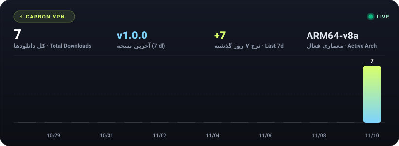

# ⚡ Carbon VPN (`v1.0.0`)

**نسل جدید کلاینت ضد فیلترینگ هوشمند با ۱۰ موتور اختصاصی، رمزنگاری سخت‌افزاری ECDSA و رابط کاربری فوق‌سریع**  
*Next-Generation Anti-DPI Tunneling Client for Android — Powered by MASQUE HTTP/2, Radiance, Gool & Serverless Engines*

[-A7F3D0?style=for-the-badge)](https://github.com/sinamp00/Carbon/releases/latest)

---

### 📥 [دانلود مستقیم نسخهٔ ۱.۰.۰ (ARM64) — Direct APK Download](https://github.com/sinamp00/Carbon/releases/latest/download/carbon-1.0.0-arm64-v8a-release.apk)
### 🌐 [مشاهدهٔ وب‌سایت رسمی کربن — Official Landing Page](https://sinamp00.github.io/Carbon/)

---

## ✨ ویژگی‌های کلیدی کربن (Carbon)

- **۱۰ پروتکل اختصاصی عبور از فیلترینگ شدید (DPI Bypass)**: مجهز به اسکنرهای توربو کلودفلر، مسک HTTP/2 و پایتون، تونل دولایه، گول وارپ، لنترن آلمان (Radiance)، آرگو فالکن و موتورهای سرورلس (بدون نیاز به سرور واسط).
- **سیستم اشتراک و لایسنس سخت‌افزاری ضد کرک (ECDSA NIST P-256)**: قفل اختصاصی روی شناسهٔ سخت‌افزاری دستگاه (`HWID`) با محافظت چندلایه در برابر دیباگر، هوک (Frida/Xposed/LSPosed)، دستکاری ساعت سیستم و شبیه‌سازها.
- **به‌روزرسانی خودکار درون‌برنامه‌ای (In-App Auto Updater)**: بررسی، دانلود و نصب مستقیم نسخه‌های جدید منتشرشده در گیت‌هاب از داخل بخش تنظیمات برنامه.
- **رابط کاربری ۱۲۰ هرتز با طراحی Material 3 Expressive**: انیمیشن‌های فوق‌روان،۱۱ پوستهٔ رنگی (Dark, AMOLED, Dracula, Catppuccin, Nord, Tokyo Night و...)، پشتیبانی کامل از فارسی و انگلیسی با ارقام انگلیسی استاندارد.

---

## 🌐 جدول ۱۰ پروتکل هستهٔ کربن

| پرچم | نام فارسی | نام انگلیسی | نشان (Badge) | کاربرد و معماری |
|:---:|:---|:---|:---:|:---|
| 🇳🇱 | **مسک توربو** | `MASQUE Turbo` | `MASQUE H2` | موتور اصلی مسک با تکه‌تکه‌سازی هدر TLS و اسکنر توربو |
| 🇫🇮 | **مسک پایتون** | `MASQUE Python` | `PYTHON` | شبیه‌سازی اثرانگشت پایتون برای عبور از فیلترینگ هوشمند اپراتورها |
| 🇨🇭 | **تونل دولایه** | `Dual Tunnel` | `DUAL HOP` | دو لایه تونل تو در توی کلودفلر برای پایداری و امنیت دوچندان |
| 🇺🇸 | **گول وارپ** | `Gool WARP` | `GOOL` | کپسوله‌سازی وایرگارد داخل مسک؛ عالی برای اینستاگرام و یوتیوب |
| 🇩🇪 | **لنترن آلمان** | `Lantern Edge` | `LANTERN` | موتور رادیانس لنترن با اتصال مستقیم به سرورهای فرانکفورت |
| 🇫🇷 | **آرگو فالکن** | `Argo Falcon` | `ARGO` | سیستم پل‌های عمومی آرگو و فالکن با سوییچ هوشمند پشتیبان |
| 🇸🇪 | **سرورلس گوگل** | `Serverless TLS` | `TLS LEAD` | اتصال مستقیم بدون سرور با خرد کردن بسته‌های TLS و دی‌ان‌اس گوگل |
| 🇬🇧 | **شکاف دامنه** | `SNI Split` | `SNI SPLIT` | عبور مستقیم از فیلترینگ با تکنیک برش نام دامنه و دی‌ان‌اس ادگارد |
| 🇦🇹 | **مسک کوییک** | `MASQUE QUIC` | `QUIC H3` | تونل نسل سوم کلودفلر بر پایهٔ کوییک؛ مناسب اینترنت خانگی و فیبر نوری |
| 🇨🇦 | **وایرگارد نویز** | `WireGuard Noise` | `WARP WG` | پروتکل وایرگارد با تزریق پکت‌های نویز ضد فیلتر و اسکنر عمیق |

---

## 🔐 دریافت اشتراک و پشتیبانی

برای دریافت کلید فعال‌سازی اختصاصی دستگاه خود، شناسهٔ سخت‌افزاری (`DEV-XXXX-XXXX`) را از بخش **تنظیمات ← حساب کاربری و اشتراک** کپی کرده و به ربات تلگرام ارسال کنید:

- 🤖 **تلگرام**: [@Sina_mp_VPNbot](https://t.me/Sina_mp_VPNbot)
- 🌐 **وب‌سایت**: [sinamp00.github.io/Carbon](https://sinamp00.github.io/Carbon/)
- 📦 **مخزن گیت‌هاب**: [github.com/sinamp00/Carbon](https://github.com/sinamp00/Carbon)

---

## 📊 نرخ دانلود و آمار زنده (Live Download Analytics)

میزان استقبال کاربران و نرخ دریافت بسته‌های نصبی کربن به صورت لحظه‌ای و زنده از طریق API رسمی گیت‌هاب پایش و مصورسازی می‌شود:

 

 

⚡ داده‌ها و نرخ دانلود به صورت پیوسته و زنده از طریق GitHub Releases API پایش و ثبت می‌شوند.

