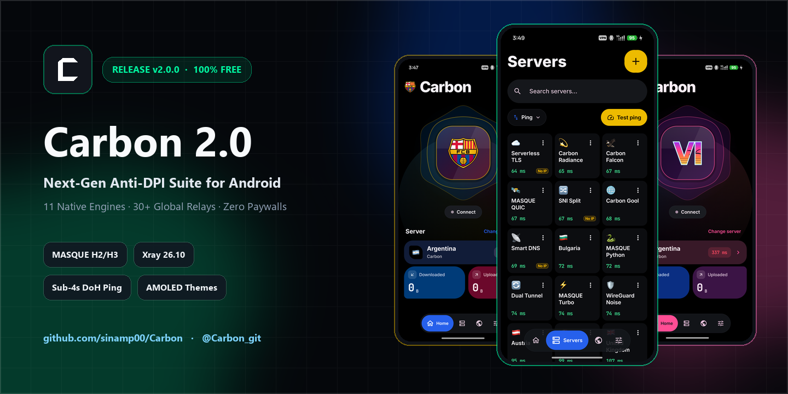
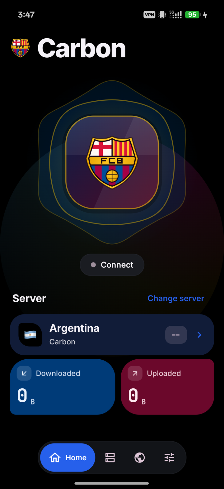
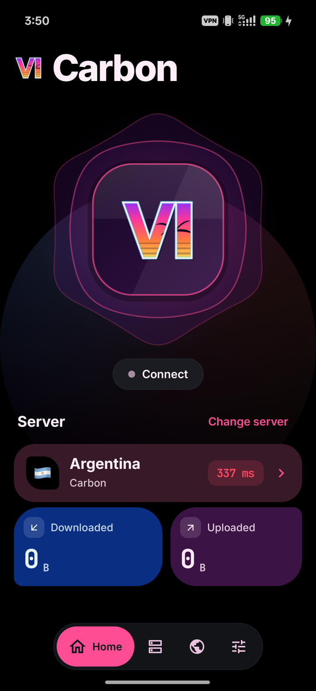
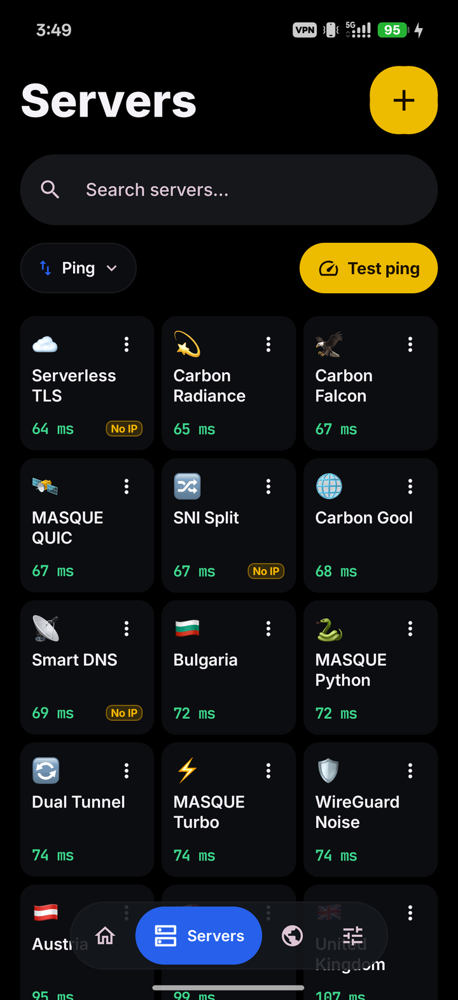
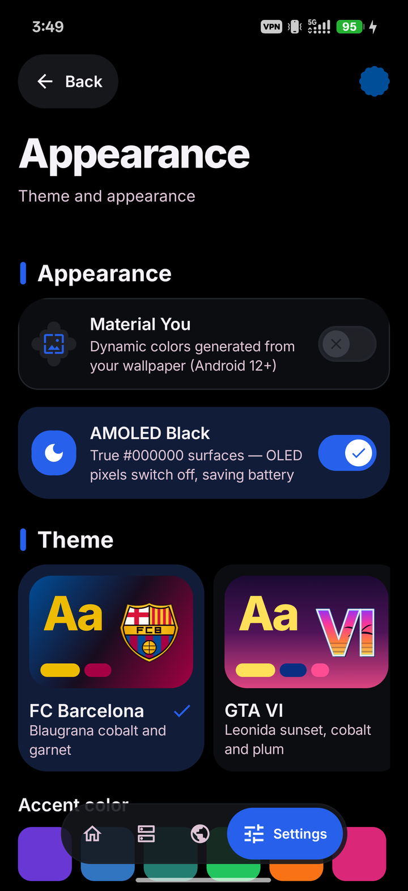
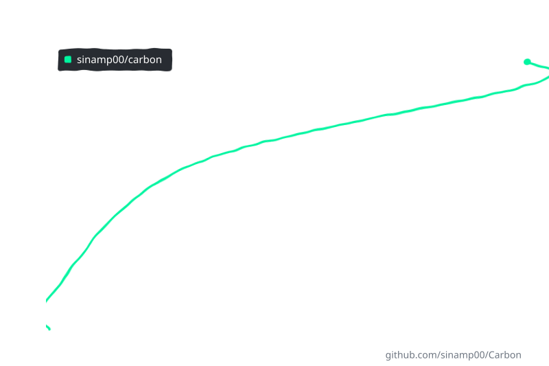

 

# ⚡ Carbon `2.0`

**Next-Generation Free Anti-DPI & Multi-Engine Tunneling Suite for Android**  
**کلاینت رایگان و نسل جدید عبور از فیلترینگ شدید اندروید با ۱۱ موتور بومی، ۳۰+ سرور جهانی و هستهٔ ترکیبی**

  
  
  
  
  

  <a href="#-direct-apk-download-v200"><b>📥 Download APK</b></a> ·
  <a href="https://sinamp00.github.io/Carbon/"><b>🌐 Official Website</b></a> ·
  <a href="#-۱۱-موتور-اختصاصی-و-معماری-کربن-۲"><b>🇮🇷 مستندات فارسی</b></a> ·
  <a href="#-11-built-in-anti-dpi-engines"><b>🇬🇧 English Docs</b></a> ·
  <a href="https://t.me/Carbon_git"><b>📢 @Carbon_git</b></a>

> ⭐ **Carbon 2.0 is 100% Free — No Accounts, No Ads, No Paywalls.**  
> If Carbon keeps you connected, please **click `★ Star` at the top-right of this repository** — every star pushes Carbon into GitHub Trending so more users in restricted networks can find it!

---

## 📱 Live App Showcase (`v2.0.0`)

<table>
  <tr>
    <td align="center" width="25%">
       
      <b>FC Barcelona Crest</b> Blaugrana Cobalt & Garnet
    </td>
    <td align="center" width="25%">
       
      <b>GTA VI Edition</b> Leonida Sunset & Plum
    </td>
    <td align="center" width="25%">
       
      <b>Sub-4s Parallel Ping</b> 11 Engines + 30+ Countries
    </td>
    <td align="center" width="25%">
       
      <b>True #000000 AMOLED</b> 14 Themes & Custom Accents
    </td>
  </tr>
</table>

---

## 📥 Direct APK Download (`v2.0.0`)

| Package Variant | Target Devices | Size | Direct Link | SHA-256 Prefix |
|:---|:---|:---:|:---:|:---|
| **ARM64-v8a** *(Recommended)* | 98% of modern Android phones (Android 8.0+) | `83.5 MB` | [**⬇ Download ARM64 APK**](https://github.com/sinamp00/Carbon/releases/latest/download/carbon-2.0.0-arm64-v8a-release.apk) | `e5b62d2a0568...` |
| **Universal** | All CPU architectures in one package | `189.6 MB` | [**⬇ Download Universal APK**](https://github.com/sinamp00/Carbon/releases/latest/download/carbon-2.0.0-universal-release.apk) | `66617d1b8364...` |
| **ARMv7 (32-bit)** | Older 32-bit Android phones & TV boxes | `59.5 MB` | [**⬇ Download ARMv7 APK**](https://github.com/sinamp00/Carbon/releases/latest/download/carbon-2.0.0-armeabi-v7a-release.apk) | `b46dde12ae12...` |
| **x86_64** | Android Studio Emulators, Chromebooks, WSA | `64.9 MB` | [**⬇ Download x86_64 APK**](https://github.com/sinamp00/Carbon/releases/latest/download/carbon-2.0.0-x86_64-release.apk) | `e134a3bbd004...` |

---

## 🚀 چه چیزهایی در کربن ۲.۰ (`Carbon 2.0`) تغییر کرده است؟

**کربن ۲.۰** بزرگ‌ترین بازطراحی معماری و رابط کاربری کربن از زمان انتشار اولیه است؛ سریع‌تر، سبک‌تر و **کاملاً رایگان برای همه**:

- 🆓 **کاملاً رایگان، بدون اکانت و بدون تبلیغات**: حذف کامل قفل‌های اشتراکی؛ بلافاصله پس از نصب به ۱۱ موتور داخلی و بیش از ۳۰ لوکیشن جهانی متصل شوید.
- ⚡ **موتور پینگ موازی فوق‌سریع (زیر ۴ ثانیه)**: مسابقه هم‌زمان بین سرورهای DoH و سوکت مستقیم که بیش از ۴۵ سرور و پروتکل را در کمتر از ۴ ثانیه پینگ می‌گیرد.
- 🛡️ **ارتقای هستهٔ سرورلس ۲۰۲۶ (`Xray 26.10.31`)**: بهره‌گیری از `finalmask.tcp` با تکه‌تکه‌سازی تطبیقی بسته‌های TLS (`128-256 byte`، تأخیر `3-8 ms` و `tcpNoDelay`) همراه با مسیریابی DNS تکه‌تکه‌شده برای عبور مستقیم از DPI بدون سرور واسط.
- 🎨 **پوسته‌های اختصاصی `GTA VI` و `FC Barcelona` + سیاه مطلق AMOLED**: نشان اختصاصی روی دکمهٔ اتصال، گلبرگ‌های هندسی دقیق، ۱۴ تم رنگی پویا، «حالت ساده» با دکمه‌های درشت و ۳ سبک نوار پیمایش.
- 🧭 **راهنمای هوشمند پروتکل‌های بدون تغییر IP (`No IP`)**: تفکیک شفاف موتورهای ضدتحریم و شکاف TLS (`Serverless TLS`، `SNI Split` و `Smart DNS`) از تونل‌های کامل تغییر IP تا همیشه بهترین ابزار را برای بازی، دانلود یا وب‌گردی انتخاب کنید.
- 📡 **اعلان زندهٔ وضعیت شبکه از گیت‌هاب + آپدیت خودکار درون‌برنامه‌ای**: اطلاع‌رسانی آنی وضعیت سرورها و دریافت مستقیم نسخه‌های جدید از داخل برنامه.

---

## 🌐 ۱۱ موتور اختصاصی و معماری کربن ۲

| نشان | نام موتور | شناسه فنی | تغییر IP | کاربرد و معماری |
|:---:|:---|:---:|:---:|:---|
| ⚡ | **مسک توربو** (`MASQUE Turbo`) | `MASQUE H2` | ✅ کامل | تونل HTTP/2 کلودفلر با تکه‌تکه‌سازی هدر TLS و اسکنر خودکار Anycast |
| 🐍 | **مسک پایتون** (`MASQUE Python`) | `PYTHON H2` | ✅ کامل | شبیه‌سازی اثرانگشت کلاینت پایتون برای عبور از فیلترینگ هوشمند اپراتورهای همراه |
| 🛡️ | **تونل دولایه** (`Dual Tunnel`) | `DUAL HOP` | ✅ کامل | کپسوله‌سازی دولایه برای پایداری بالا روی شبکه‌های پرنوسان |
| 🌐 | **کربن گول** (`Carbon Gool`) | `GOOL` | ✅ کامل | زنجیرهٔ هوشمند رله‌های Gool با اسکنر `ironclad`؛ ایده‌آل برای اینستاگرام و یوتیوب |
| 🏮 | **کربن رادیانس** (`Carbon Radiance`) | `RADIANCE` | ✅ کامل | موتور ضدسانسور تطبیقی با تغییر پویای مسیرهای مسدودشده |
| 🦅 | **کربن فالکن** (`Carbon Falcon`) | `FALCON` | ✅ کامل | شبکهٔ پل‌های توزیع‌شده با سوییچ خودکار پشتیبان |
| 🚀 | **مسک کوییک** (`MASQUE QUIC`) | `QUIC H3` | ✅ کامل | تونل نسل سوم کلودفلر بر پایهٔ QUIC/HTTP3؛ مناسب فیبر نوری و اینترنت خانگی |
| 🔒 | **وایرگارد نویز** (`WireGuard Noise`) | `WG NOISE` | ✅ کامل | پروتکل وایرگارد با تزریق پکت‌های فریبندهٔ ضد DPI |
| ☁️ | **سرورلس گوگل** (`Serverless TLS`) | `XRAY 26.10` | 🔸 بدون تغییر IP | تکه‌تکه‌سازی مستقیم `ClientHello` روی لبهٔ دستگاه بدون سرور واسط و افت سرعت |
| 🔀 | **شکاف دامنه** (`SNI Split`) | `SNI SPLIT` | 🔸 بدون تغییر IP | عبور مستقیم از بازرسی SNI با پینگ فوق‌پایین و بدون مصرف سرور واسط |
| 📡 | **دی‌ان‌اس هوشمند** (`Smart DNS`) | `ANTI-403` | 🔸 بدون تغییر IP | رفع تحریم سرویس‌های بازی و توسعه‌دهندگان با کمترین پینگ ممکن |

> 🌍 **بیش از ۳۰ کشور در بخش سرورهای جهانی کربن**: علاوه‌بر ۱۱ موتور بالا، سرورهای پرسرعت **HTTP/2 و HTTP/3** بیش از ۳۰ کشور (آلمان، هلند، بریتانیا، فنلاند، سوئیس، آمریکا، بلغارستان، اتریش، ژاپن و...) به همراه پشتیبانی کامل از لینک‌های اشتراک خارجی (`VLESS`، `Reality`، `Hysteria2`، `TUIC`، `Trojan`، `VMess` و `WireGuard`) مستقیماً درون برنامه در دسترس هستند.

---

## 📢 جامعهٔ کاربری و حمایت از پروژه

کربن به‌صورت رایگان برای دسترسی آزاد همهٔ کاربران توسعه داده می‌شود:

- 📢 **کانال رسمی تلگرام (اخبار، آپدیت‌ها و وضعیت سرورها)**: [@Carbon_git](https://t.me/Carbon_git)
- 🌐 **وب‌سایت رسمی کربن ۲.۰**: [sinamp00.github.io/Carbon](https://sinamp00.github.io/Carbon/)
- ⭐ **حمایت با یک کلیک**: اگر از کربن راضی هستید، همین حالا دکمهٔ **Star ⭐** بالای صفحهٔ گیت‌هاب را بزنید و لینک مخزن را با دوستانتان به اشتراک بگذارید!

---

## 🇬🇧 11 Built-In Anti-DPI Engines

Carbon 2.0 fuses **Aether MASQUE**, **Sing-box**, and **Xray 26.10.31** inside one native Jetpack Compose Material 3 client:

1. **Full Encrypted VPN Tunnels (IP Masked)**:
   - `MASQUE Turbo (HTTP/2)` · `MASQUE Python` · `Dual Tunnel` · `Carbon Gool` · `Carbon Radiance` · `Carbon Falcon` · `MASQUE QUIC (HTTP/3)` · `WireGuard Noise` + **30+ Global Country Relays** (`HTTP/2` & `HTTP/3`).
2. **Ultra-Low-Latency Direct Bypass (`No IP` Badge)**:
   - `Serverless TLS (Xray 26.10 finalmask.tcp)` · `SNI Split` · `Smart Anti-Sanction DNS` — slices TLS handshakes and resolves clean encrypted DNS directly on-device with zero proxy bottleneck.
3. **Universal Protocol Client**:
   - Import subscriptions, QR codes, and custom configs (`VLESS`, `XTLS-Reality`, `Hysteria2`, `TUIC v5`, `Trojan`, `VMess`, `Shadowsocks`, `WireGuard`) with per-app Split Tunneling, LAN proxy sharing, and In-App OTA updates.

---

## ⭐ Star & Download History

<a href="https://star-history.com/#sinamp00/Carbon&Date">
  <picture>
    <source media="(prefers-color-scheme: dark)" srcset="https://api.star-history.com/svg?repos=sinamp00/Carbon&type=Date&theme=dark" />
    <source media="(prefers-color-scheme: light)" srcset="https://api.star-history.com/svg?repos=sinamp00/Carbon&type=Date" />
    
  </picture>
</a>

  

<a href="https://github.com/sinamp00/Carbon/releases">
  <picture>
    <source media="(prefers-color-scheme: dark)" srcset="assets/download-history-dark.svg" />
    <source media="(prefers-color-scheme: light)" srcset="assets/download-history-light.svg" />
    
  </picture>
</a>

  

**Built for an open internet · [Download v2.0.0](https://github.com/sinamp00/Carbon/releases/latest) · [Website](https://sinamp00.github.io/Carbon/) · [Telegram @Carbon_git](https://t.me/Carbon_git)**

